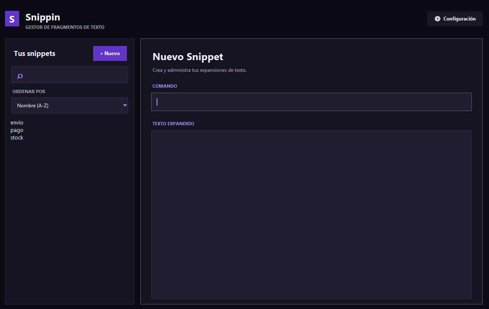
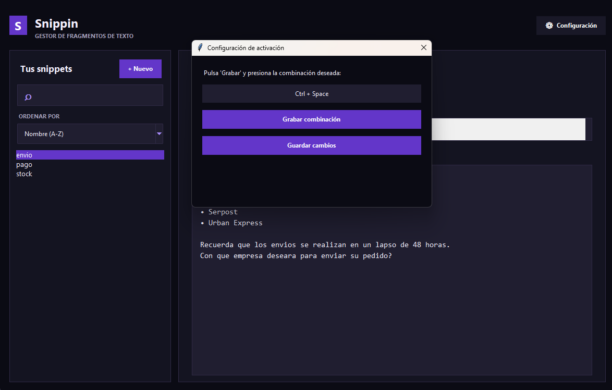
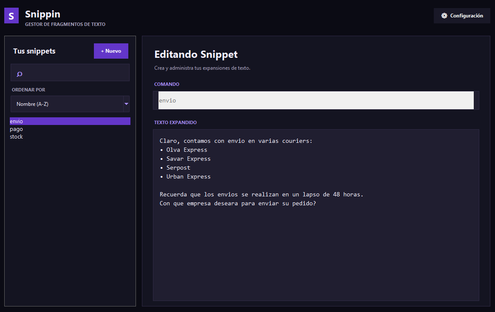

# ⚡ Snippin

Una aplicación de escritorio ligera desarrollada en **Python (Tkinter)**, diseñada para optimizar la productividad mediante la expansión automática de fragmentos de texto (*snippets*) en tiempo real, utilizando ganchos de teclado globales (*Global Keyboard Hooks*).

## 🚀 Características principales

- **Modo oscuro moderno:** Interfaz minimalista con una paleta de colores oscuros y acentos violetas, diseñada para ofrecer una experiencia visual agradable.
- **Expansión global:** Funciona en diferentes aplicaciones de Windows, como editores de código, navegadores y aplicaciones de mensajería.
- **Gestión dinámica:** Permite añadir, editar, eliminar y buscar fragmentos de texto desde una interfaz gráfica.
- **Personalización de teclas:** Configura tu propia combinación de activación, incluyendo `TAB`, `F1-F24` y combinaciones como `Ctrl`, `Alt`, `Shift` y `Win`.
- **Ordenamiento inteligente:** Organiza tus snippets por nombre, fecha de creación o última modificación.
- **Persistencia en JSON:** Los comandos se almacenan localmente en el archivo `command.json`.

## 📸 Vistas previas

| Interfaz principal | Panel de configuración | Gestión de comandos |
| :----------------: | :--------------------: | :-----------------: |
|   |  |  |

## ⚙️ Requisitos del sistema

- **Sistema operativo:** Windows 10 o Windows 11.
- **Lenguaje:** Python 3.10 o superior.
- **Gestor de paquetes:** pip.
- **Permisos:** Puede ser necesario ejecutar la aplicación como administrador para habilitar los ganchos de teclado globales.

## 🛠️ Instalación y ejecución

1. Clona el repositorio en tu equipo:

   ```bash
   git clone https://github.com/nezts08/SnippinPy.git
   ```

2. Accede al directorio del proyecto:

   ```bash
   cd SnippinPy
   ```

3. Instala los requerimientos necesarios:

   ```powershell
   py -m pip install -r .\requerimientos.txt
   ```

4. Ejecuta la aplicación:

   ```powershell
   py snippin.py
   ```

## 📂 Estructura del proyecto

```text
Snippin/
├── preview/
│   ├── preview.png
│   ├── configure.png
│   └── command.png
├── src/
│   ├── command.json
│   └── snippin.py
├── requerimientos.txt
└── README.md
```

## 💾 Almacenamiento

Todos los fragmentos de texto se guardan localmente en `command.json`, permitiendo conservar tus comandos y configuración entre ejecuciones.

## ⚠️ Consideraciones

- No elimines `command.json` si deseas conservar tus snippets.
- Algunas aplicaciones pueden requerir permisos elevados para permitir la expansión de texto.
- La aplicación utiliza el portapapeles para insertar el contenido de los snippets.

---

**Desarrollado para mejorar la productividad y agilizar las tareas repetitivas.** ⚡
